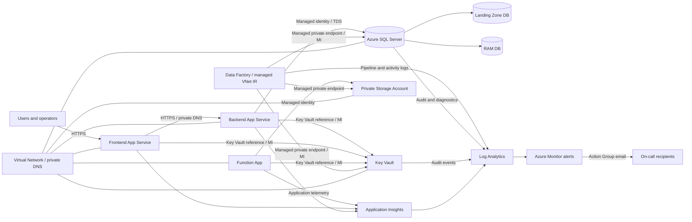

# RAM-Collins Azure architecture

## Overview

Each environment is deployed into its own resource group, virtual network, and Terraform state key. The frontend and backend use separate Linux App Service Plans; the Function App uses a separate Linux Elastic Premium plan. Application secrets are referenced from an RBAC-enabled Key Vault, and service-to-service authentication uses user- or system-assigned managed identities.

## Traffic and trust boundaries

- Private endpoints and private DNS cover the App Services, Function App, SQL server, Key Vault, Storage account, and Data Factory control endpoint.
- App Services and Functions use regional VNet integration for outbound access. Data Factory uses a managed virtual network integration runtime and managed private endpoints for SQL, Key Vault, and Storage.
- Public inbound access is disabled by default for app services, Data Factory, Storage, SQL, and Key Vault. Public availability tests are optional because a public synthetic probe cannot reach a private-only frontend.
- Application code, data factory pipelines, source-specific linked services, secrets, and SQL schema are deployment inputs owned by the application team; this repository provisions the platform and safe connection foundations.

## Components

| Concern | Implementation |
|---|---|
| Network | `modules/networking` creates delegated integration/PE subnets, private DNS zones, and VNet links. |
| Application | `modules/app_service` and `modules/function_app` create TLS-only Linux apps, health checks, diagnostics, and managed identities. |
| Data | `modules/sql_server`, `modules/sql_database`, and `modules/data_factory` configure Entra-only SQL, retention, linked services, and managed IR. |
| Secrets | `modules/key_vault` enables RBAC, soft delete, purge protection, private networking, and audit logs. |
| Telemetry | `modules/monitoring` provides workspace-based Application Insights, a Workbook, and optional synthetic availability tests. |
| Alerts | `modules/alerts` configures App Service and Function health metric downtime alerts plus high-severity API, SQL connectivity, ADF pipeline, and optional synthetic availability alerts. |

## Resource and state boundaries

`environments/dev`, `environments/test`, and `environments/prod` hold independent sizing inputs and backend state keys. The state bootstrap is intentionally separate and should be deployed once per subscription or state-management boundary.
